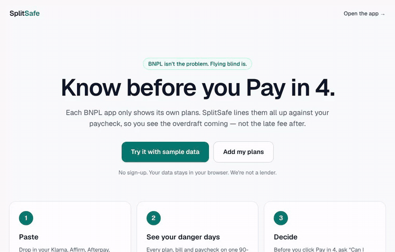
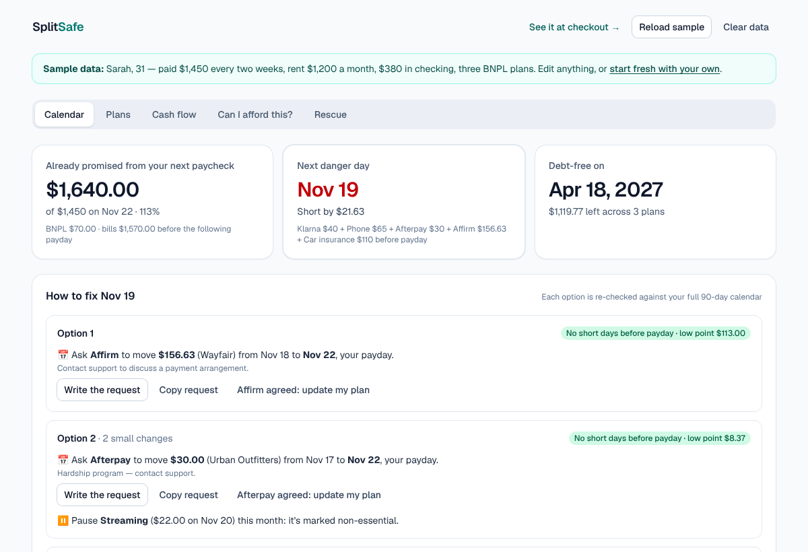
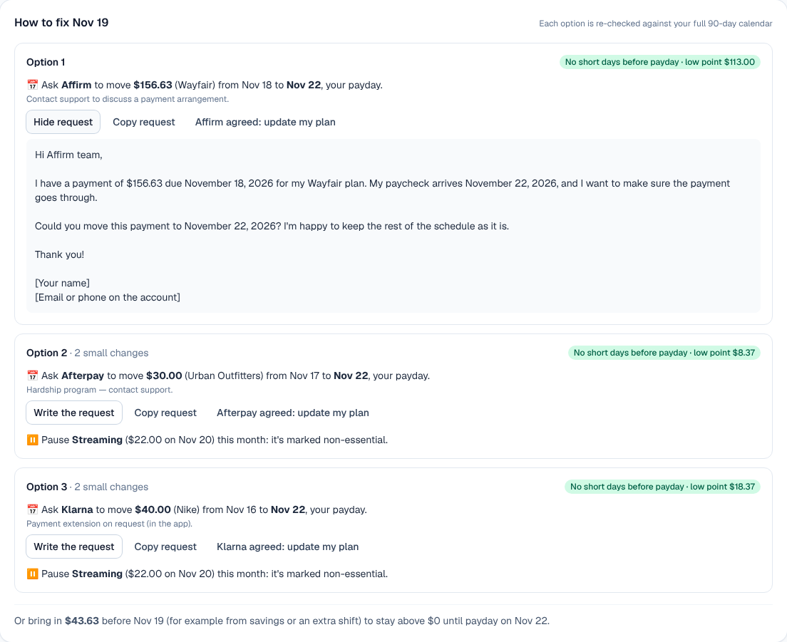
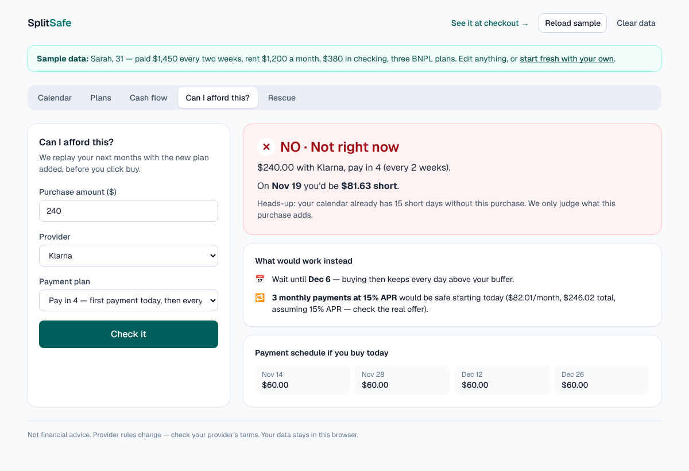
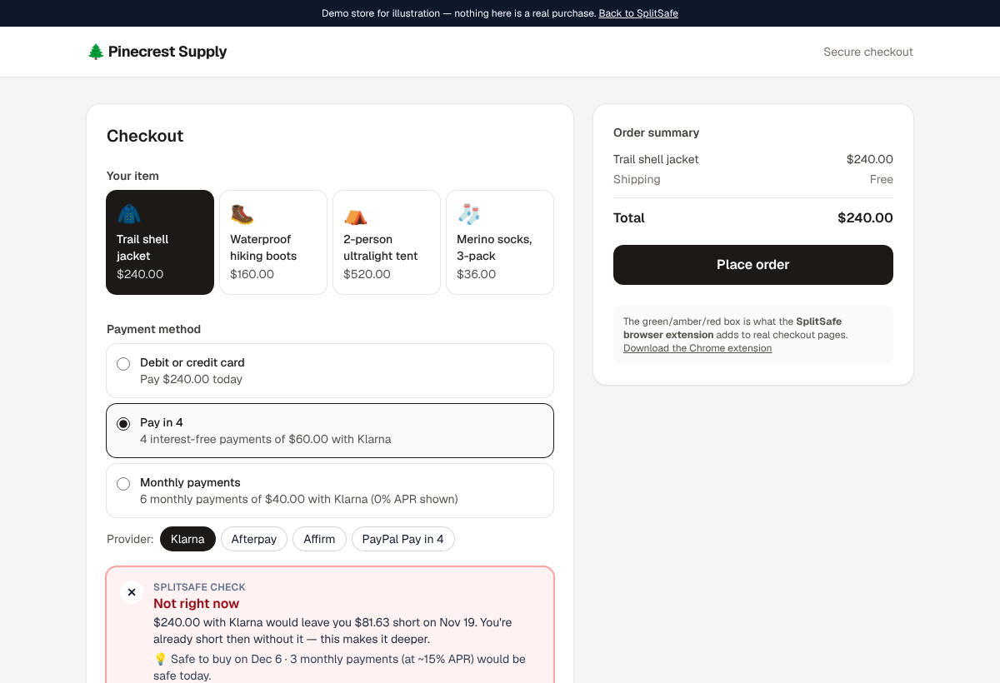
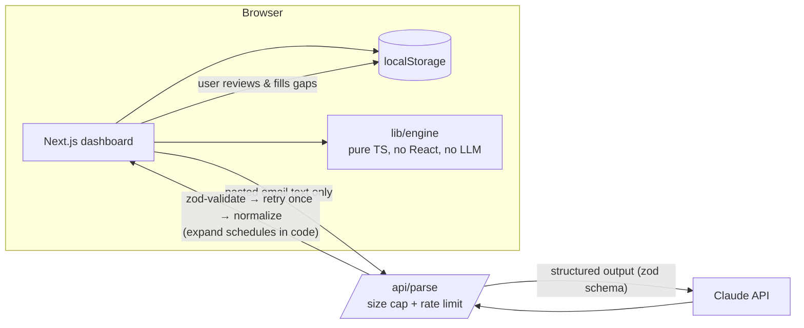

# SplitSafe — know before you "Pay in 4"

> **BNPL isn't the problem. Flying blind is.**

**Live demo: [splitsafe-phi.vercel.app](https://splitsafe-phi.vercel.app)** · no sign-up: click **Try it with sample data**.

**Pitch deck:** [deck/SplitSafe-pitch-deck.pdf](deck/SplitSafe-pitch-deck.pdf) (10 slides; source in [deck/index.html](deck/index.html), every figure cited on the slide).



## The problem

US adults aged 25–45 stack Buy Now, Pay Later plans across Klarna, Affirm, Afterpay, PayPal Pay in 4, Zip and Sezzle. Each app shows only its own plans, so nobody sees the combined picture against the paycheck. Autopays overdraw the account, late fees pile up, and since 2025 Affirm reports every loan, Pay in 4 included, to Experian and TransUnion.

People don't hate BNPL. They hate not seeing what's coming. SplitSafe puts every plan, bill and paycheck on one calendar and shows the day you'd run short, before it happens. **We are not a lender and never sell credit.**

## What it does

| | |
|---|---|
| **Add plans** | Paste one or more confirmation emails. Claude pulls out each plan, then you review and fix it in a table before saving. You can also add, edit and delete plans by hand. |
| **Cash flow** | Checking balance, take-home pay, pay frequency (weekly / every 2 weeks / twice a month / monthly), next payday, recurring bills, and a safety buffer. |
| **Cash calendar** | A day-by-day projected balance for the next 90 days. Red days are **short** (below $0) and amber days are **tight** (below the buffer). Three headline cards: *already promised from your next paycheck*, *next danger day* (with the payments behind it), and *debt-free on*. |
| **Safe to spend until payday** | One number at the top of the calendar: how much can leave checking before the next paycheck while every day stays above the buffer (and why it's $0 when it is). |
| **Fix my danger day** | Concrete options, each re-checked against the full calendar: *ask Affirm to move $156.63 to payday*, *pause Streaming this month*, or a small mix. Each comes with a ready-to-send request and an "they agreed, update my plan" button, plus the cash needed as a fallback. |
| **Add to my calendar** *(Plus)* | One click exports every BNPL payment and danger-day warning (with reminders) as an `.ics` file for Google, Apple or Outlook Calendar. |
| **Weekly check-in** | When you come back, SplitSafe replays what was scheduled since your last visit (paychecks, bills, BNPL autopays). You confirm which payments went through and correct the balance, and the calendar continues from real numbers. Payoff progress and check-ins build up over time. For judges: *Simulate coming back a week later* in the sample banner. |
| **Pay off early** *(Plus)* | For each plan: the earliest date in the next 60 days it can be cleared without creating a tight or short day, the estimated payoff (remaining principal at the plan's APR), the interest saved and the new debt-free date. Free users see the headline saving as a teaser. |
| **Bank statement import** | Upload a CSV from any US bank (Chase, BofA, Wells Fargo layouts and more). It's **parsed in the browser and never uploaded**: balance, paycheck and frequency, recurring bills (essentials flagged), average everyday spending, and **BNPL payments recognised by their descriptors** (`KLARNA*`, `AFFIRM*`, `AFTERPAY*`…), turned into plan drafts to review. A sample Chase-style statement is built in for judges ([example file](docs/sample-statement-sarah.csv), [what the import finds](docs/bank-import.png)). |
| **Plus, 7 days free** | Everything that runs on *your own numbers* is Plus ($4.99/mo or $39.99/yr): calendar, safe-to-spend, fixes, "Can I afford this?", check-ins, payoff planner and alerts. **Always free:** the full demo with sample data, importing data, and Rescue mode. A locked tab shows a real teaser from your data ("14 short days in your next 90, the first in 7 days"). Test-mode checkout: card `4242 4242 4242 4242`; `4000 0000 0000 0002` shows a decline. |
| **Can I afford this?** | Enter an amount, a provider and a term (Pay in 4, or N months at an APR). You get **SAFE / TIGHT / NO**, the first problem date and amount, the earliest safe purchase date within 60 days, and a safer term if one exists. |
| **Rescue mode** | "My income dropped": shows which payments fail and when, ranks what to protect first (essentials, then payments that affect your credit, then late-fee payments), and writes a polite hardship request for each provider with a copy button. |

## 60-second tour

| | |
|---|---|
| **1. See the danger.** One click loads Sarah's data: 113% of her next paycheck is already promised, and she's short on a day 5 days out. |  |
| **2. Fix it.** Move one payment to payday, or pause a non-essential bill. Every option is re-simulated; the request message is written for you. |  |
| **3. Decide before buying.** A $240 Klarna purchase gets **NO**, with the exact day it bites, a safe date, and a safer term. |  |
| **4. At checkout.** The same check appears next to "Pay in 4" in the store (demo page and Chrome extension). |  |
| **5. When income drops.** Rescue mode ranks what to protect first and drafts hardship requests. |  |

### Business model and retention

- **Who pays:** the user, B2C only. We take no lender commissions and never sell data, so incentives stay on the user's side.
- **Why Plus:** setup and the demo are free, so people see the problem on sample data and get a teaser from their own ("14 short days ahead") before paying. The paid value is ongoing: a calendar that stays right through weekly check-ins, a check before every BNPL purchase, and payoff timing. **ROI:** overdraft fees at some big US banks are still around $34–35 (e.g. Chase, Wells Fargo; verify current fee schedules), and BNPL late fees run up to ~$7–8. Avoiding one fee covers months of Plus.
- **7-day free trial, annual plan preselected** to favour renewals over one-off use.
- **Why they come back:** BNPL schedules run every 2 weeks, so there's always a next payment. The weekly check-in keeps the calendar accurate (data that compounds), shows payoff progress, and surfaces the next danger day. Retention is tied to an ongoing obligation rather than to novelty.
- **Rescue mode stays free:** charging people in a hardship month is the wrong incentive, and it builds the trust that converts later.

### Demo script for presenting

1. Open the [landing page](https://splitsafe-phi.vercel.app), then click **Try it with sample data**.
2. **Calendar:** point at the three cards ("113% already promised", "short in 5 days", "debt-free date").
3. **How to fix:** open *Write the request* for the Affirm option, then click *Affirm agreed*. The danger day disappears.
4. **Can I afford this?:** it's pre-filled with $240 Klarna, so click **Check it** to get NO, a safe date and a safer term.
5. **See it at checkout:** switch items and terms in the demo store and watch the verdict change.
6. Close with: *"BNPL isn't the problem. Flying blind is. We're not a lender, and your data never leaves your browser."*

### At checkout: demo page + browser extension

Two ways to show the "Can I afford this?" check where people actually buy:

- **[Checkout demo](https://splitsafe-phi.vercel.app/demo/checkout):** a fictional store whose checkout shows the SplitSafe verdict live as you switch items, providers and terms. No install needed.
- **Chrome extension ([`extension/`](extension/README.md)):** it detects "4 payments of $60"-style offers on real checkout pages and shows the verdict in a small card. It uses the same engine, runs entirely on-device, and syncs your plans from the SplitSafe site. [Download the zip](https://splitsafe-phi.vercel.app/splitsafe-extension.zip), then use "Load unpacked" in `chrome://extensions`.

BNPL providers don't let third parties add messages inside their own checkout, so the extension works at the page level and needs no partnership.

### Demo story (sample data)

Sarah is 31 and takes home $1,450 every two weeks. Rent is $1,200 a month, and she has $380 in checking. She has three plans: Klarna sneakers ($160, Pay in 4), an Afterpay jacket ($120, Pay in 4), and an Affirm couch ($900 over 6 months at 15% APR). All dates are relative to today, so the demo always shows:

- a **red danger day about 5 days out**, short by $21.63 because five autopays land before payday;
- **113% of her next paycheck already promised**;
- **"Can I afford a $240 Klarna purchase?" → NO**, with a suggested safe date and a safer term;
- at least one **working fix** for the danger day.

Unit tests check this story against every day of a full year.

## How it works: engine vs LLM

All financial logic is deterministic TypeScript. The LLM's only job is to turn messy email text into JSON.



- **`lib/engine/`** holds pure functions only: payday generation, installment schedules (pay-in-4, amortized monthly, rule expansion), the 90-day daily simulation, insights, affordability with the earliest-safe-date search, danger-day fix suggestions, and rescue prioritization. Each takes `today` as an argument, so results are reproducible and testable.
- **`lib/engine/providers.ts`** is the single config for provider rules: late fee, credit-bureau reporting, hardship options, `sourceUrl`, `lastVerified`, and a `verified` flag. Rules we haven't verified are labeled as unverified in the UI.
- **`/api/parse`** sends the pasted text to Claude with a zod schema as the structured output format, validates the result with zod, and retries once. Then **code, not the model**, normalizes provider names and expands rules like "4 payments of $25 every 2 weeks starting Nov 20". Missing dates or amounts stay empty and are highlighted for the user to fill in. Nothing is ever invented.
- **Privacy:** there's no database and no auth. Plans and cash flow live only in your browser's localStorage. The only data that leaves the browser is the pasted email text, sent once for parsing and not stored.

## Dependencies

- **Next.js 15 + React 19 + TypeScript + Tailwind**, deployed on **Vercel**.
- **Anthropic Claude API** (`@anthropic-ai/sdk`, model from `ANTHROPIC_MODEL`), used only in `/api/parse` to turn pasted email text into JSON. The key stays on the server.
- **zod** (validation), **Recharts** (balance chart), **vitest** (tests), **esbuild** + **adm-zip** (extension bundle).
- No database, no auth, and no payment processor. Checkout is a clearly labeled test mode, and card data never leaves the browser.

## Run locally

```bash
npm install
cp .env.example .env.local   # add ANTHROPIC_API_KEY; ANTHROPIC_MODEL defaults to claude-opus-5-5
npm run dev                  # http://localhost:3000
```

Everything except email parsing works without an API key. Without one, the parse route returns a friendly error and the UI offers manual entry.

### Tests

```bash
npm test        # vitest: engine + parser normalization
npm run lint
npm run build
```

The tests cover payday generation for every frequency (including month-end and the 31st), installment scheduling and rounding, the daily simulation (same-day ordering, partially paid plans, overdue installments, empty state), shortfall detection, affordability verdicts, the earliest-safe-date search, the debt-free date, rescue ranking, hardship messages, and LLM-output normalization. CI runs lint, tests and build on every push.

## Project structure

```
app/
  page.tsx              landing + pricing
  app/page.tsx          dashboard
  api/parse/route.ts    email → JSON (the only server code)
components/             tabs, editors, UI primitives
lib/
  engine/               deterministic financial engine + tests
  parse/                LLM output schema, normalization, rate limiter
  bnpl-detect.ts        finds "4 payments of $X" offers in page text (extension)
  verdict-copy.ts       verdict wording shared by the checkout demo and the extension
  ics.ts                .ics calendar export of payments and danger days
  sample-data.ts        date-relative demo persona and emails
  schemas.ts            zod schemas for persisted state
extension/              Chrome extension (MV3): sync, detect, verdict card
docs/                   screenshots
DECISIONS.md            judgment calls made during the build
```

## Limitations

- Projections only cover what you enter. Everyday spending is modeled as recurring bills, so add groceries and gas as bills for a realistic picture.
- Events are calendar days in your local timezone. Paychecks are assumed to post before that day's bills and autopays.
- The rate limiter runs in memory per serverless instance. That's enough for a demo; production would use a shared store.
- Provider rules change. Only Affirm, Klarna and Afterpay are marked verified (as of the `lastVerified` date), and the rest are marked unverified. This is not financial advice.
- Data lives in one browser. Clearing site data removes it.

## Roadmap

- **Email auto-import:** a read-only Gmail/Outlook connection that picks up new BNPL confirmations automatically.
- **Unrecognized-new-loan alerts:** flag a BNPL plan you didn't open, as an early fraud signal.
- **Plaid sync:** a real checking balance and detected recurring bills instead of manual entry.
- **Browser extension → Web Store:** the MVP in `extension/` works today. Next: a Chrome Web Store listing, Safari/iOS support, and more offer formats.
- Plus tier: danger-day alerts and a weekly forecast email.

---

_Not financial advice. Provider rules change, so check your provider's terms._
