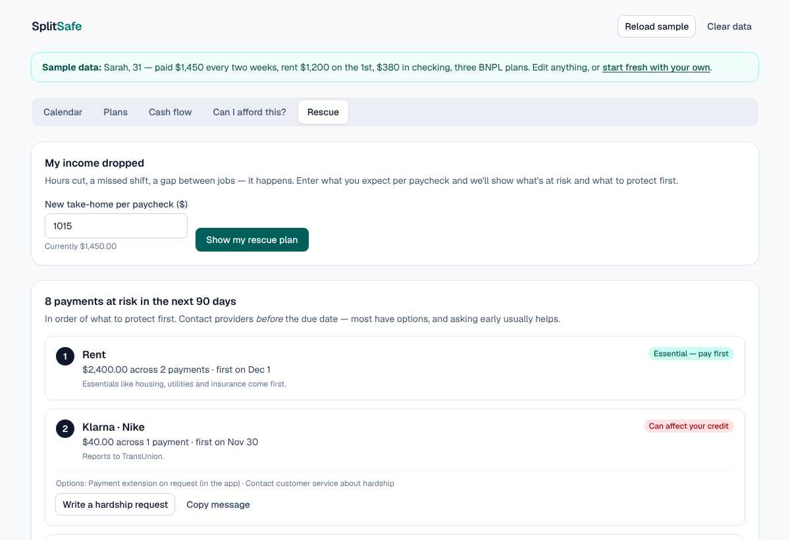
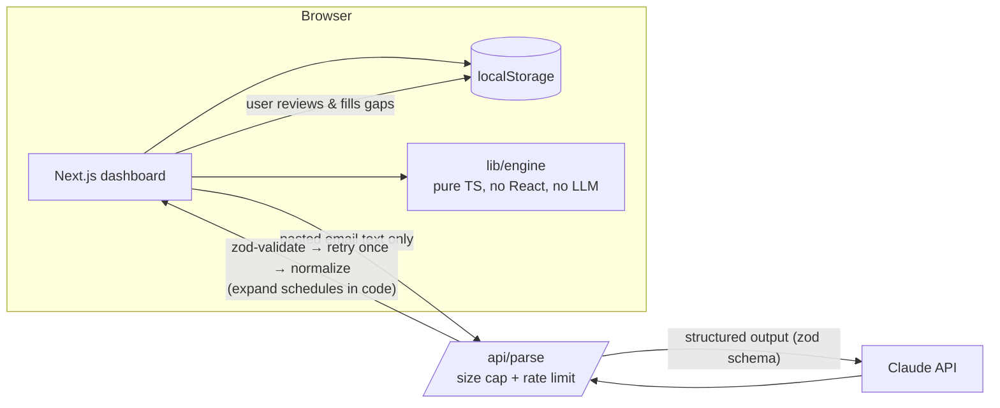

# SplitSafe — know before you "Pay in 4"

> **BNPL isn't the problem. Flying blind is.**

**Live demo:** _add the Vercel URL here_ · no sign-up: click **Try it with sample data**.


## The problem

US adults aged 25–45 stack Buy Now, Pay Later plans across Klarna, Affirm, Afterpay, PayPal Pay in 4, Zip and Sezzle. Each app shows only its own plans, so nobody sees the combined picture against the paycheck. Autopays overdraw the account, late fees pile up, and since 2025 Affirm and Klarna report to credit bureaus.

People don't hate BNPL. They hate not seeing what's coming. SplitSafe puts every plan, bill and paycheck on one calendar and shows the day you'd run short, before it happens. **We are not a lender and never sell credit.**

## What it does

| | |
|---|---|
| **Add plans** | Paste one or more confirmation emails. Claude pulls out each plan, then you review and fix it in a table before saving. You can also add, edit and delete plans by hand. |
| **Cash flow** | Checking balance, take-home pay, pay frequency (weekly / every 2 weeks / twice a month / monthly), next payday, recurring bills, and a safety buffer. |
| **Cash calendar** | A day-by-day projected balance for the next 90 days. Red days are **short** (below $0) and amber days are **tight** (below the buffer). Three headline cards: *already promised from your next paycheck*, *next danger day* (with the payments behind it), and *debt-free on*. |
| **Can I afford this?** | Enter an amount, a provider and a term (Pay in 4, or N months at an APR). You get **SAFE / TIGHT / NO**, the first problem date and amount, the earliest safe purchase date within 60 days, and a safer term if one exists. |
| **Rescue mode** | "My income dropped": shows which payments fail and when, ranks what to protect first (essentials, then payments that affect your credit, then late-fee payments), and writes a polite hardship request for each provider with a copy button. |

<p>


</p>

### Demo story (sample data)

Sarah is 31 and takes home $1,450 every two weeks. Rent is $1,200 on the 1st, and she has $380 in checking. She has three plans: Klarna sneakers ($160, Pay in 4), an Afterpay jacket ($120, Pay in 4), and an Affirm couch ($900 over 6 months at 15% APR). All dates are relative to today, so the demo always shows:

- a **red danger day about 5 days out**, short by $21.63 because five autopays land before payday;
- **113% of her next paycheck already promised**;
- **"Can I afford a $240 Klarna purchase?" → NO**, with a suggested safe date and a safer term.

A unit test checks this story against every day of a full year.

## How it works: engine vs LLM

All financial logic is deterministic TypeScript. The LLM's only job is to turn messy email text into JSON.



- **`lib/engine/`** holds pure functions only: payday generation, installment schedules (pay-in-4, amortized monthly, rule expansion), the 90-day daily simulation, insights, affordability with the earliest-safe-date search, and rescue prioritization. Each takes `today` as an argument, so results are reproducible and testable.
- **`lib/engine/providers.ts`** is the single config for provider rules: late fee, credit-bureau reporting, hardship options, `sourceUrl`, `lastVerified`, and a `verified` flag. Rules we haven't verified are labeled as unverified in the UI.
- **`/api/parse`** sends the pasted text to Claude with a zod schema as the structured output format, validates the result with zod, and retries once. Then **code, not the model**, normalizes provider names and expands rules like "4 payments of $25 every 2 weeks starting Nov 20". Missing dates or amounts stay empty and are highlighted for the user to fill in. Nothing is ever invented.
- **Privacy:** there's no database and no auth. Plans and cash flow live only in your browser's localStorage. The only data that leaves the browser is the pasted email text, sent once for parsing and not stored.

## Run locally

```bash
npm install
cp .env.example .env.local   # add ANTHROPIC_API_KEY; ANTHROPIC_MODEL defaults to claude-opus-5-5
npm run dev                  # http://localhost:3000
```

Everything except email parsing works without an API key. Without one, the parse route returns a friendly error and the UI offers manual entry.

### Tests

```bash
npm test        # vitest: engine + parser normalization
npm run lint
npm run build
```

The tests cover payday generation for every frequency (including month-end and the 31st), installment scheduling and rounding, the daily simulation (same-day ordering, partially paid plans, overdue installments, empty state), shortfall detection, affordability verdicts, the earliest-safe-date search, the debt-free date, rescue ranking, hardship messages, and LLM-output normalization. CI runs lint, tests and build on every push.

## Project structure

```
app/
  page.tsx              landing + pricing
  app/page.tsx          dashboard
  api/parse/route.ts    email → JSON (the only server code)
components/             tabs, editors, UI primitives
lib/
  engine/               deterministic financial engine + tests
  parse/                LLM output schema, normalization, rate limiter
  sample-data.ts        date-relative demo persona and emails
  schemas.ts            zod schemas for persisted state
docs/                   screenshots
DECISIONS.md            judgment calls made during the build
```

## Limitations

- Projections only cover what you enter. Everyday spending is modeled as recurring bills, so add groceries and gas as bills for a realistic picture.
- Events are calendar days in your local timezone. Paychecks are assumed to post before that day's bills and autopays.
- The rate limiter runs in memory per serverless instance. That's enough for a demo; production would use a shared store.
- Provider rules change. Only Affirm, Klarna and Afterpay are marked verified (as of the `lastVerified` date), and the rest are marked unverified. This is not financial advice.
- Data lives in one browser. Clearing site data removes it.

## Roadmap

- **Email auto-import:** a read-only Gmail/Outlook connection that picks up new BNPL confirmations automatically.
- **Unrecognized-new-loan alerts:** flag a BNPL plan you didn't open, as an early fraud signal.
- **Plaid sync:** a real checking balance and detected recurring bills instead of manual entry.
- **Browser checkout extension:** "Can I afford this?" right on the Pay in 4 button.
- Plus tier: danger-day alerts and a weekly forecast email.

---

_Not financial advice. Provider rules change, so check your provider's terms._
